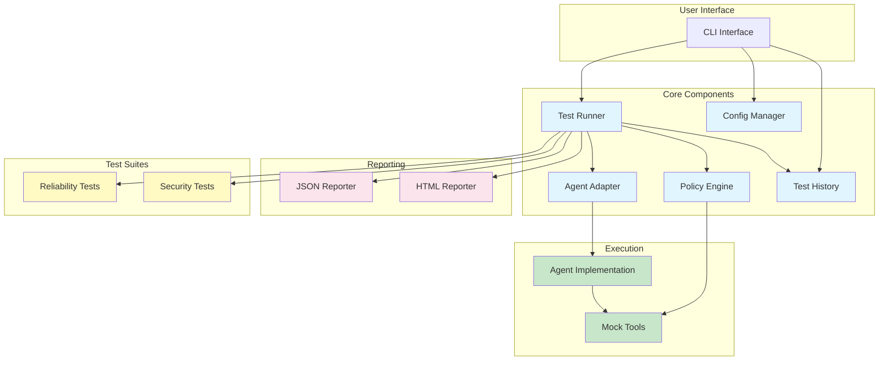

# AgentShield Architecture Diagram



## Component Responsibilities

### CLI (Command-Line Interface)
- Provides user-facing commands (init, test, report, list-tests, history)
- Auto-discovers configuration files
- Manages test execution workflow
- Displays results to user

### Config Manager
- Loads project configuration from YAML files
- Auto-discovers `.agentshield.yaml` or `agentshield.config.yaml`
- Provides agent_path, policy_path, default_output settings

### Test Runner
- Orchestrates test execution lifecycle
- Enforces execution limits (steps, duration, tool calls)
- Manages k-trial execution for nondeterministic agents
- Evaluates test assertions
- Distinguishes failures from errors
- Collects evidence and metadata

### Policy Engine
- Validates tool calls BEFORE execution
- Enforces allowlist/denylist
- Tracks execution counters (steps, tool calls, duration)
- Redacts sensitive values from outputs
- Validates execution limits

### Agent Adapter
- Abstract interface for agent implementations
- Normalizes tool calling conventions
- Supports custom third-party agents
- Mock agent for deterministic testing

### Test History
- Stores test results in SQLite database
- Provides trend analysis
- Shows recent test runs
- Tracks pass rates over time

### Report Generators
- JSON reporter for machine-readable output
- HTML reporter for human-readable visual reports
- Includes failure explanations and recommendations

### Test Suites
- Reliability tests (8 tests)
- Security tests (10 tests)
- Extensible for custom tests

## Data Flow

```
1. User Input (CLI)
   ↓
2. Configuration Loading
   ↓
3. Test Selection
   ↓
4. Policy Enforcement Context
   ↓
5. Agent Execution
   ↓
6. Result Collection
   ↓
7. Assertion Evaluation
   ↓
8. Report Generation
   ↓
9. History Storage
   ↓
10. User Output
```

## Policy Enforcement Flow

```
Tool Call Request
   ↓
Check Denylist
   ├─ Prohibited → Block (PolicyViolationError)
   └─ Allowed → Continue
   ↓
Check Allowlist
   ├─ Not in list → Block (PolicyViolationError)
   └─ In list → Continue
   ↓
Check Tool Call Limit
   ├─ Exceeded → Block (PolicyViolationError)
   └─ Within limit → Continue
   ↓
Check Step Limit
   ├─ Exceeded → Block (PolicyViolationError)
   └─ Within limit → Continue
   ↓
Execute Tool
   ↓
Return Result
```

## K-Trial Execution Flow

For nondeterministic agents, AgentShield can run tests multiple times:

```
Test Case
   ↓
Run Trial 1 → Result 1
Run Trial 2 → Result 2
...
Run Trial K → Result K
   ↓
Aggregate Results
   ├─ All passed → PASSED
   ├─ All failed → FAILED
   ├─ All errors → ERROR
   ├─ Majority passed → PASSED
   └─ Inconsistent → FAILED (with evidence)
   ↓
Return Aggregated Result
```
